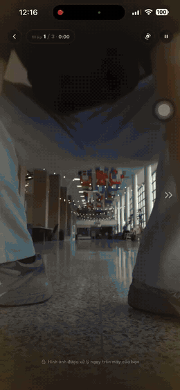
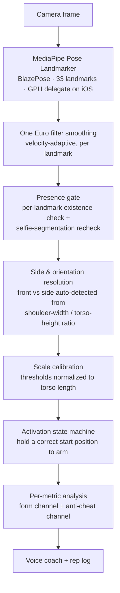

# Vika - an AI form coach that runs entirely on-device

**Flutter · Dart · MediaPipe (BlazePose) · Supabase** · [live on the App Store](https://apps.apple.com/us/app/id6768359920?pt=128883254&ct=github), ~1,200 downloads, built for the Vietnamese market.

**By the numbers:** 31 exercises (17 rep-counted, 14 timed holds) · ~156K lines of Dart · 2,400+ automated tests · ~30 fps on-device pose tracking

Vika watches you exercise through your phone camera, counts your reps, rejects the fake ones,
detects form faults, and coaches you by voice in Vietnamese. All pose inference runs on-device
at ~30 fps; no video ever leaves the phone.

> **This is a showcase repo.** The production codebase is private (it is a company codebase with
> tuned detection thresholds). The excerpts here are real production code,
> lightly abridged. Full source walkthrough available in interviews — ducnam883@gmail.com.

---

## Demo

  
  &nbsp;&nbsp;&nbsp;
  

Real app captures. **Left:** live squat tracking — the smoothed skeleton overlay, the rep
counter, and a coaching cue (*"LÊN!"* — up!) as the state machine confirms the ascent.
**Right:** the activation state machine — a set arms only after the user holds a correct start
position for 3 seconds, which is also the window where their personal baselines are calibrated.
The footer line in the app reads *"Hình ảnh được xử lý ngay trên máy của bạn"* — your images
are processed right on your device.

---

## Why this is hard

- **Mid-range hardware.** The target user runs a 360×800 budget Android, not an iPhone Pro.
  Everything — pose inference, segmentation, smoothing, per-metric analysis — fits in a ~33 ms
  frame budget on that phone.
- **Noisy input.** Pose landmarks jitter frame-to-frame, hallucinate when nobody is in frame,
  and degrade when limbs occlude each other in side view.
- **No ground truth.** There is no sensor confirming a rep happened. Every count the app shows
  has to be defensible from geometry alone — including against a user actively trying to cheat it.
- **Bodies differ.** A fixed pixel threshold that works for one person fails for another.
  Every motion threshold is normalized to the user's own torso scale and time-scaled to
  measured FPS, so detection is device- and body-independent.

## Architecture: the per-frame pipeline

Each stage is owned by the shared base framework — an individual exercise never touches the
camera, the filter, or presence logic.

## The exercise framework

The product needs dozens of exercises from a very small team. That only works if adding an
exercise is *cheap*, so the framework is a strict template method. The base class owns the
per-frame pipeline, the activation lifecycle, baseline calibration, the attempt boundary and
**one shared phase machine** (`rest → outbound → apex → inbound`) that runs every rep exercise.
A concrete exercise contributes only **declaration and geometry**:

| Hook | What the exercise supplies |
|---|---|
| `returnSignal` | the one signal that defines the movement (squat: knee angle, closing), its noise floor and its direction rate per second |
| `phasePlan` | where the apex line sits and how close to rest counts as back |
| `deriveRepFrame(landmarks)` | the geometry: joint angles and distances for this frame |
| `bufferedSignals(frame)` | which signals the motion buffer tracks |
| `metrics` | one collection of form and anti-cheat metrics (see below) |
| `boundaryBindings` | checks resolved once per attempt, such as the squat's cheat line on depth |
| `onFrameHook(frame)` | projecting the generic phase onto the exercise's own names |

Everything else is inherited: sampling a personal baseline during the 3-second activation hold,
the 150 ms entry-intent confirm that keeps jitter from opening an attempt, direction read over
real elapsed time instead of frame deltas, stillness and retrace for credit, and accept or
reject bookkeeping at the boundary. All 31 shipped exercises (17 rep, 14 hold) run on these
bases, and the squat leaf is about 340 lines.

→ [`excerpts/rep_exercise_base.dart`](excerpts/rep_exercise_base.dart) · [`excerpts/squat.dart`](excerpts/squat.dart)

## Metrics: form coaching and anti-cheat are separate channels

Every form aspect (depth, tempo, trunk lean, heel lift…) is a small `Metric` object with a
shared lifecycle contract: per-frame `update`, state-transition hooks, fault recording with
per-attempt dedup, and rep counting. Exercises compose metrics instead of growing a god class.

The important design decision: **anti-cheat metrics are the same class with one different
word.** Each metric declares a channel, and the engine derives every routing, halting and
counting rule from it:

- The **credit channel** answers *"is this even the exercise?"*: a squat that never leaves
  standing, a knee that folds without the thigh moving. Its faults refuse the attempt out loud.
- The **coach channel** answers *"was that rep good?"*: a marginal-but-real attempt is always
  **counted and coached, never blocked**. Guide, don't punish.

This split is a product stance as much as an architecture: users lose trust instantly when a
real rep doesn't count, and gain nothing from being coached on a rep that never happened. A
metric that can decline to judge a rep also publishes how many reps it actually judged, so a
fault rate never turns into praise for something nobody measured.

→ [`excerpts/metric_base.dart`](excerpts/metric_base.dart)

## Zero false reps: presence, not visibility

Early builds hallucinated reps in an empty room — the pose model happily invents a skeleton in
furniture. The fix was realizing the model exposes two per-landmark confidences that mean
different things:

- **Visibility** — "is this landmark unoccluded, given it exists?" Noisy: it reads ~0.5 on a
  perfectly real but occluded back leg in side view. Gating on it rejects real reps.
- **Presence** — "does this landmark exist in the scene at all?" It stays high for occluded
  real limbs and craters within a single frame when the person leaves.

Gating on **presence** (with visibility only as a weak secondary filter against fully
extrapolated landmarks) drove false rep counts to zero on empty-room validation captures, while
keeping legitimately occluded landmarks trackable. A segmentation-based person detector
independently rechecks the scene when frame-level presence dips or landmarks drift to the frame
edge.

→ [`excerpts/presence_gating.dart`](excerpts/presence_gating.dart)

## Beyond the camera

- **Recommendation engine** — generates 7-week periodized plans (2 progressive phases + deload)
  from a scored exercise catalog: weighted scoring across goal / level / pain-area / cooldown,
  epsilon-greedy exploration over the top candidates, MMR for slot diversity, and
  session-to-session autoregulation (last session's achieved volume floors the next
  prescription).
- **Voice coaching** — post-rep coaching in Vietnamese by default, real-time cues reserved for
  safety. Cue cadence is deliberately stochastic (probability + "hunger" shaping per cue
  channel) so the coach never turns into a metronome.
- **Data honesty as a rule** — coaching text is generated only from fault counts the system
  actually measured. The app never tells a user something it didn't see.
- **Thresholds tuned on real sessions** — a recorded set saves a trace of its pose landmarks, never
  video. A replay tool feeds those traces back through the production exercise code, so a threshold change is
  measured against real device sessions before it ships. Example: over 16,375 replayed frames, a
  5-frame stillness window cut moving frames misread as still from 1,418 to 1,068.
- **Testing the failure modes that matter** — widget tests load the real production font
  (the test-default font measures text ~2× too wide and green-lights layouts that truncate
  Vietnamese diacritics on device) and assert against *silent* truncation, not just thrown
  overflow errors.

## Validation before code

Vika was market-tested before it was built: a 151-respondent survey defined the target customer
(Vietnamese office workers, 25–45) and set the launch price. Detection mechanics for each
exercise are specified against physical-therapy sources before implementation.

---

*Code excerpts © 2026 Vika (Vui Khỏe An Toàn). Shared for portfolio evaluation; no license granted.*
*Duc Nam Nguyen — [ducnam883@gmail.com](mailto:ducnam883@gmail.com) · [linkedin.com/in/duc-nam-nguyen](https://linkedin.com/in/duc-nam-nguyen)*
