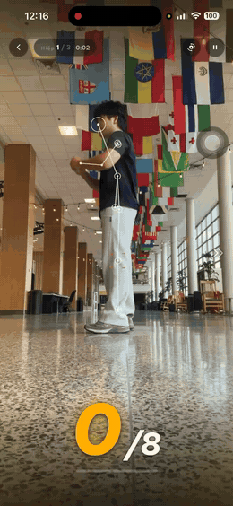
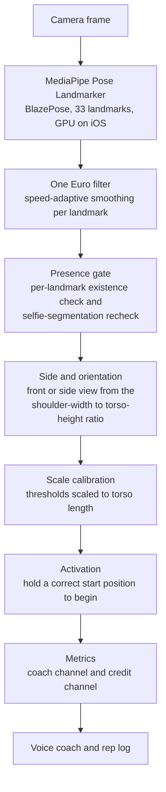

# Vika: an on-device AI form coach

Flutter, Dart, MediaPipe (BlazePose) and Supabase. [Live on the App Store](https://apps.apple.com/us/app/id6768359920?pt=128883254&ct=github) with about 1,200 downloads, built for Vietnamese users.

Vika watches you exercise through your phone camera. It counts your reps, refuses the fake ones, finds form faults and coaches you by voice in Vietnamese. Pose tracking runs on the phone at about 30 fps, and no video leaves the device.

| | |
|---|---|
| Exercises | 31 (17 counted by rep, 14 timed holds) |
| Code | about 156K lines of Dart |
| Tests | 2,400+ |
| Pose rate | 29.6 to 30.1 fps measured on device |

> This is a showcase repo. The production codebase is private because it belongs to the company and holds tuned detection thresholds. The excerpts are abridged copies of current production code. I can walk through the full source in an interview: ducnam883@gmail.com.

---

## Demo

  
  &nbsp;&nbsp;&nbsp;
  

Both clips are real app captures. On the left, the app tracks a squat with a smoothed skeleton, counts the rep and says *"LÊN!"* ("up!") once it confirms the ascent. On the right, a set starts only after the user holds a correct start position for 3 seconds. The app calibrates that user's own baselines during the hold. The footer reads *"Hình ảnh được xử lý ngay trên máy của bạn"*, which means "your images are processed on your device."

---

## The hard parts

- **Cheap phones.** The app targets a 360x800 budget Android, not an iPhone Pro. Pose inference, segmentation, smoothing and every metric share one frame.
- **Noisy input.** Landmarks jitter from frame to frame. The model invents a skeleton when nobody is there, and it loses limbs that block each other in a side view.
- **No ground truth.** No sensor confirms that a rep happened. Every count has to follow from geometry, including when the user is trying to cheat.
- **Different bodies.** A pixel threshold that fits one person fails for the next. Every motion threshold scales to the user's torso length and to real elapsed time, so the same numbers work on any phone and any body.

## The per-frame pipeline

The shared base runs every stage. An exercise never touches the camera, the filter or the presence logic.

## The exercise framework

A small team can only build dozens of exercises if each new one is cheap to add. So the base class owns the frame loop, activation, baseline calibration, the attempt boundary and one phase machine (`rest`, `outbound`, `apex`, `inbound`) that every rep exercise shares. An exercise supplies only declarations and geometry:

| Hook | What the exercise supplies |
|---|---|
| `returnSignal` | the signal that defines the movement (for a squat, the knee angle, which closes), its noise floor and its direction rate per second |
| `phasePlan` | where the apex line sits and how close to rest counts as back |
| `deriveRepFrame(landmarks)` | joint angles and distances for this frame |
| `bufferedSignals(frame)` | the signals the motion buffer tracks |
| `metrics` | one collection of form and anti-cheat metrics |
| `boundaryBindings` | checks run once per attempt, such as the squat's minimum depth |
| `onFrameHook(frame)` | mapping the shared phase onto the exercise's own phase names |

The base handles the rest. It samples a personal baseline during the 3-second hold. It waits 150 ms of steady movement before it opens an attempt, so jitter can't start one. It reads direction over real elapsed time instead of from two frames, and it does the accept or refuse bookkeeping at the end of each attempt. All 31 exercises run on these bases. The squat file is about 340 lines.

See [`excerpts/rep_exercise_base.dart`](excerpts/rep_exercise_base.dart) and [`excerpts/squat.dart`](excerpts/squat.dart).

## Coaching and anti-cheat use the same metric class

Each form check (depth, tempo, trunk lean, heel lift) is a small metric object with a shared lifecycle: `update` on every frame, hooks for phase changes, fault recording with one record per fault per attempt, and rep counting. Exercises combine metrics instead of growing one large class.

Anti-cheat rules are the same class. Each metric declares a channel, and the engine decides routing, halting and counting from that one field.

- The credit channel asks whether the movement is the exercise at all. A squat that never leaves standing fails it, and so does a knee that bends while the thigh stays still. The app refuses that attempt and says why.
- The coach channel asks whether the rep was good. The app counts a marginal but real rep and coaches it. It never blocks it.

The split is a product decision. Users stop trusting the app the moment a real rep doesn't count, and coaching a rep that never happened helps nobody. A metric that sometimes can't judge a rep also reports how many reps it did judge. Without that count, a metric that judged nothing looks like a perfect score, and the app would praise form it never measured.

See [`excerpts/metric_base.dart`](excerpts/metric_base.dart).

## No reps in an empty room

Early builds counted reps in an empty room, because the pose model drew a skeleton on the furniture. The model gives two confidence values per landmark, and they measure different things:

- Visibility is the chance a landmark is unblocked, given that it exists. A real back leg in a side-view squat reads about 0.5, so gating on visibility refuses real reps.
- Presence is the chance the landmark exists at all. It stays high for a blocked real limb and drops within one frame when the person leaves.

The app gates on presence and keeps visibility as a loose second check for landmarks the model made up. An empty room now produces zero landmarks over a 14.7-second capture, and occluded limbs still track. A segmentation-based person detector rechecks the scene when average presence drops or landmarks drift to the edge of the frame.

See [`excerpts/presence_gating.dart`](excerpts/presence_gating.dart).

## Other parts of the app

- **Workout plans.** The recommendation engine builds 7-week plans with two progressive phases and a deload week. It scores the catalog by goal, level, pain area and cooldown, explores among the top candidates with epsilon-greedy selection and uses MMR to keep slots varied. Each session's achieved volume sets the floor for the next prescription.
- **Voice coaching.** The coach speaks after each rep by default and saves real-time cues for safety. Each cue channel fires on a probability that rises the longer it stays quiet, so the coach doesn't repeat itself on a fixed beat.
- **Honest coaching text.** The app builds coaching text only from fault counts it measured.
- **Thresholds tuned on recorded sessions.** A recorded set saves a trace of pose landmarks, never video. A replay tool runs those traces through the production exercise code, so each threshold change is checked against real sessions before it ships. Over 16,375 replayed frames, a 5-frame stillness window cut moving frames misread as still from 1,418 to 1,068.
- **Tests that catch real failures.** Widget tests load the production font. Flutter's default test font measures text about twice as wide, which hides layouts that cut off Vietnamese diacritics on a phone. The tests check for silent truncation, not only for overflow errors.

## Research before code

A 151-person survey defined the target customer (Vietnamese office workers aged 25 to 45) and set the launch price before any code was written. Each exercise's detection rules are written from physical-therapy sources before it is built.

---

*Code excerpts © 2026 Vika (Vui Khỏe An Toàn). Shared for portfolio review; no license granted.*
*Duc Nam Nguyen, [ducnam883@gmail.com](mailto:ducnam883@gmail.com), [linkedin.com/in/duc-nam-nguyen](https://linkedin.com/in/duc-nam-nguyen)*
