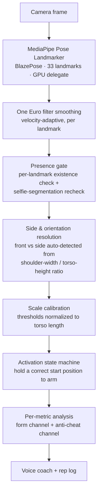

# Vika — an AI form coach that runs entirely on-device

**Flutter · Dart · MediaPipe (BlazePose) · Supabase** — pre-launch, built for the Vietnamese market.

Vika watches you exercise through your phone camera, counts your reps, rejects the fake ones,
detects form faults, and coaches you by voice in Vietnamese. All pose inference runs on-device
at ~30 fps; no video ever leaves the phone.

> **This is a showcase repo.** The production codebase is private (it is a company codebase with
> tuned, physician-reviewed detection thresholds). The excerpts here are real production code,
> lightly abridged. Full source walkthrough available in interviews — ducnam883@gmail.com.

---

## Demo

<!-- TODO: media/demo.gif — rep counting + voice coaching, live -->
<!-- TODO: media/empty_room.gif — empty-room capture, zero false reps -->
*Demo clips coming shortly: live rep counting with Vietnamese voice coaching, and an
empty-room capture demonstrating zero hallucinated reps.*

---

## Why this is hard

- **Mid-range hardware.** The target user runs a 360×800 budget Android, not an iPhone Pro.
  Everything — pose inference, segmentation, smoothing, per-metric analysis — fits in a ~33 ms
  frame budget on that phone.
- **Noisy input.** Pose landmarks jitter frame-to-frame, hallucinate when nobody is in frame,
  and degrade when limbs occlude each other in side view.
- **No ground truth.** There is no sensor confirming a rep happened. Every count the app shows
  has to be defensible from geometry alone — including against a user actively trying to cheat it.
- **Bodies differ.** A fixed pixel threshold that works for one person fails for another.
  Every motion threshold is normalized to the user's own torso scale and time-scaled to
  measured FPS, so detection is device- and body-independent.

## Architecture: the per-frame pipeline

Each stage is owned by the shared base framework — an individual exercise never touches the
camera, the filter, or presence logic.

## The exercise framework

The product needed ~40 exercises built by a two-person team in two months. That only works if
adding an exercise is *cheap*, so the framework is a strict template method: the base class owns
the entire per-frame pipeline, the activation lifecycle, baseline calibration, and the attempt
boundary. A concrete exercise contributes only **declaration and geometry**:

| Hook | What the exercise supplies |
|---|---|
| `requiredSideLandmarks` | which landmarks this movement needs |
| `isInPreparedStartPosition(frame)` | pure setup geometry: is this a valid start? |
| `updateStateMachine(frame)` | the movement's phase transitions |
| `buildContext(frame)` / `buildCompletion(frame)` | typed evidence handed to metrics |
| `formMetrics` / `antiMetrics` | composed per-aspect analyzers (see below) |

Everything else — sampling a personal baseline during the 3-second activation hold, freezing it,
drift-refreshing it only during calm in-band frames, accept/reject bookkeeping at the attempt
boundary — is inherited. Two developers shipped 40 exercises in two months on this surface.

→ [`excerpts/prepared_exercise_base.dart`](excerpts/prepared_exercise_base.dart)

## Metrics: form coaching and anti-cheat are separate channels

Every form aspect (depth, tempo, body line, neck position…) is a small `Metric` object with a
shared lifecycle contract: per-frame `update`, state-transition hooks, fault recording with
per-attempt dedup, and log aggregation. Exercises compose metrics instead of growing a god class.

The important design decision: **anti-cheat metrics are the same class, registered in a separate
collection.** The two channels answer different questions:

- The **anti channel** answers *"is this even the exercise?"* — a squat that never leaves
  standing, a plank lying on the floor. Its faults gate credit: the attempt is rejected, not
  coached.
- The **form channel** answers *"was that rep good?"* — a marginal-but-real attempt is always
  **counted and coached, never blocked**. Guide, don't punish.

This split is a product stance as much as an architecture: users lose trust instantly when a
real rep doesn't count, and gain nothing from being coached on a rep that never happened.

→ [`excerpts/metric_base.dart`](excerpts/metric_base.dart)

## Zero false reps: presence, not visibility

Early builds hallucinated reps in an empty room — the pose model happily invents a skeleton in
furniture. The fix was realizing the model exposes two per-landmark confidences that mean
different things:

- **Visibility** — "is this landmark unoccluded, given it exists?" Noisy: it reads ~0.5 on a
  perfectly real but occluded back leg in side view. Gating on it rejects real reps.
- **Presence** — "does this landmark exist in the scene at all?" It stays high for occluded
  real limbs and craters within a single frame when the person leaves.

Gating on **presence** (with visibility only as a weak secondary filter against fully
extrapolated landmarks) drove false rep counts to zero on empty-room validation captures, while
keeping legitimately occluded landmarks trackable. A segmentation-based person detector
independently rechecks the scene when frame-level presence dips or landmarks drift to the frame
edge.

→ [`excerpts/presence_gating.dart`](excerpts/presence_gating.dart)

## Beyond the camera

- **Recommendation engine** — generates 7-week periodized plans (2 progressive phases + deload)
  from a scored exercise catalog: weighted scoring across goal / level / pain-area / cooldown,
  epsilon-greedy exploration over the top candidates, MMR for slot diversity, and
  session-to-session autoregulation (last session's achieved volume floors the next
  prescription).
- **Voice coaching** — post-rep coaching in Vietnamese by default, real-time cues reserved for
  safety. Cue cadence is deliberately stochastic (probability + "hunger" shaping per cue
  channel) so the coach never turns into a metronome.
- **Data honesty as a rule** — coaching text is generated only from fault counts the system
  actually measured. The app never tells a user something it didn't see.
- **Testing the failure modes that matter** — widget tests load the real production font
  (the test-default font measures text ~2× too wide and green-lights layouts that truncate
  Vietnamese diacritics on device) and assert against *silent* truncation, not just thrown
  overflow errors.

## Validation before code

Vika was market-tested before it was built: a 151-respondent survey defined the target customer
(Vietnamese office workers, 25–45) and set the launch price. The exercise catalog (126 movements
across strength and yoga) was reviewed with a physician advisor; detection mechanics for each
exercise are specified against physical-therapy sources before implementation.

---

*Code excerpts © 2026 Vika (Vui Khỏe An Toàn). Shared for portfolio evaluation; no license granted.*
*Duc Nam Nguyen — [ducnam883@gmail.com](mailto:ducnam883@gmail.com) · [linkedin.com/in/duc-nam-nguyen](https://linkedin.com/in/duc-nam-nguyen)*
